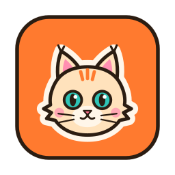

# Nyeko

**Nyo, a little cat in your Mac's notch (or at the top of your screen on Windows), who keeps an eye on your AI coding
agents, and lets you run them and your computers from your phone.**

---

## What it does

- **Coding agents at a glance**: every Claude Code, Codex, Gemini CLI session is listed live; approve or deny a
  permission, answer Claude's questions, read and message a session, or start a new one.
- **Your computers from your phone**: one phone holds several computers (each Mac account and each Windows PC is its
  own), end-to-end encrypted through your own relay. Volume, media, lock, sleep, restart, shut down, open any app.
- **A Mac controller**: now playing, the next meeting, the Notetaker, quick-launch apps and quick actions in the island,
  dictation anywhere, and Nyo's chat, which runs Mac commands first.

| | |
|---|---|
| **Mac** | `NotchBuddy/` — Swift 6, SwiftUI + AppKit. Scheme `Nyeko`, bundle `com.broliix.nyeko`. |
| **Windows / Linux** | `windows/` — Tauri 2 (Rust + TypeScript). |
| **Android** | `android/` — Kotlin, Jetpack Compose. App id `com.broliix.nyeko.android`. |
| **iPhone** | `phone/web/` — the web app (Add to Home Screen), on Cloudflare Pages. |
| **Relay** | `android/relay/` — a stateless Cloudflare Worker that only forwards encrypted frames. |

## Get it

Download page: **https://nyeko-phone.pages.dev/download** (Mac, Windows, Android; iPhone opens the web app).

## Build and release

- Mac, every day: `./scripts/nyeko-install.sh`.
- Windows / Linux: `cd windows && npm install && npm run tauri dev`.
- Android: `cd android && ./gradlew assembleDebug`.
- **Releases**: GitHub › Actions › **Release Nyeko** › Run workflow. It builds the three installers from `main` and
  publishes them together as one release; the download page and the Android app's updater pick it up.
- Phone and relay setup: [`phone/README.md`](phone/README.md).

## Nyeko's own sounds

The 29 sounds are made from nothing but maths: `python3 scripts/nyeko-sounds.py` writes them for the Mac, Windows
and Android apps.

## Credits and licence

Nyeko is based on **[Coucou](https://github.com/Louis-CFM/coucou)** by Louis Raillé (MIT) and on **Coucou for
Android** by Rhytam Biswas (MIT). Thank you both: the island, the hooks, the phone link and much more started there.
Their copyright notices stay in [`LICENSE`](LICENSE) and [`android/LICENSE`](android/LICENSE), next to Nyeko's.

- **Code**: MIT License, as Coucou's. Use it, fork it, learn from it.
- **Nyo, the Nyeko name, the icons and the sounds**: © 2026 Rohil Sagar, all rights reserved. They are not covered by
  the MIT License, even where code draws or generates them. See [`LICENSE-ASSETS.md`](LICENSE-ASSETS.md).
- **Coucou's name, Mochi, its icon, sounds and media** belong to Louis Raillé and are not part of Nyeko.
- **Fonts in the phone web app**: [Fredoka](https://github.com/hafontia/Fredoka-One) and [Nunito](https://github.com/googlefonts/nunito), SIL Open Font License 1.1 (`phone/web/fonts/`).

Nyeko is an independent project. It is not made, endorsed or supported by Louis Raillé or the Coucou project; please
send Nyeko's issues here, not to Coucou.
